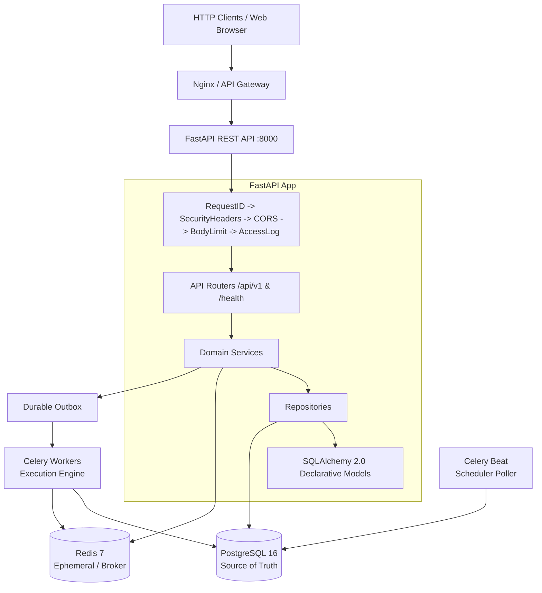

# FlowForge — Architecture Overview

## 1. System Vision & Purpose

FlowForge is a lightweight, production-grade workflow automation and asynchronous job processing platform built with Python 3.12, FastAPI, SQLAlchemy 2.0 (synchronous with psycopg3), PostgreSQL 16, Redis 7, and Celery.

The platform enables users to define linear multi-step automation workflows triggered manually, on a schedule, or via signed incoming webhooks.

---

## 2. Layered Architecture

---

## 3. Core Architectural Principles (Binding Decisions)

1. **PostgreSQL as Sole Source of Truth (D-02):**
   Redis stores exclusively transient data (queues, rate-limit counters, token denylists, heartbeats). No restart or flushing of Redis can cause workflow execution state loss.

2. **Durable Outbox Pattern (D-10):**
   When an execution is initiated, the database row is committed first in state `queued`, and only then dispatched to Celery. A background sweeper task picks up any execution row not picked up within 30 seconds.

3. **Step Snapshotting (D-03):**
   Workflow definitions are immutable JSONB snapshots on `workflow_versions`. Executions pin to a version snapshot; there is no mutable `workflow_steps` table.

4. **Security by Design:**
   - Password hashing via Argon2id.
   - Encrypted integration credentials and webhook secrets using Fernet symmetric encryption.
   - Strict SSRF protections on outbound HTTP requests.
   - Request-ID correlation tracing across API requests, database rows, and worker tasks.
